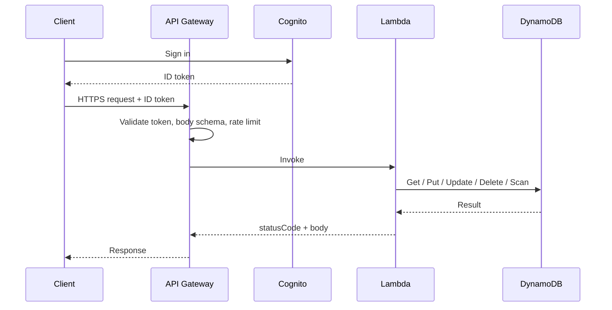

# Provider Directory API

A serverless REST API on AWS for managing healthcare-provider records, built as a hands-on learning project. The company, the scenario, and all data are fictional and synthetic.


## Problem

Acme Health (fictional) keeps master data on healthcare providers: name, specialty, city, and status. Its CRM, mobile app, partner portal, and reporting all need that data. Today each system keeps its own copy or reads the database directly, so the copies drift apart, anyone with database access can read or change everything, a traffic spike can overload the database, and nobody can tell who changed what.

This project replaces that with one API that is the only way into provider records. It authenticates every caller, validates every request, scales without capacity planning, costs almost nothing when idle, and makes failures visible.

## Architecture

1. The client signs in to Amazon Cognito and receives an ID token.
2. The client calls API Gateway with the token in the `Authorization` header.
3. API Gateway validates the token, checks the request body against a schema, and applies rate limits.
4. API Gateway invokes one of five Lambda functions (Python) through proxy integration.
5. The function reads or writes the `providers` table in DynamoDB through its own least-privilege IAM role.
6. Lambda logs, API Gateway access logs, and metrics go to CloudWatch, and alarms notify by email through SNS.



### Services and why

| Service | Role | Why this choice |
| --- | --- | --- |
| API Gateway (REST) | Front door: auth, body validation, throttling, access logs | Rejects bad or excessive requests before any code runs |
| Cognito user pool | Issues and checks tokens | Self sign-up is off, so only created users can get a token |
| Lambda (Python) | One function per operation | No servers to size, pay per request, one IAM role per function |
| DynamoDB | System of record | Known key-based access patterns, scales without administration |
| IAM | Permissions | Each function can perform exactly one DynamoDB action on one table |
| CloudWatch and SNS | Logs, metrics, dashboard, alarms, email alerts | The system reports problems instead of waiting to be asked |

## API reference

All routes require the header `Authorization: <ID token>` (the raw token, no `Bearer` prefix).

| Method | Path | Purpose | Success | Errors |
| --- | --- | --- | --- | --- |
| GET | `/providers` | List providers; optional filters `city`, `specialty`, `status` | 200 | 400, 401, 429 |
| POST | `/providers` | Create a provider | 201 | 400, 401, 409, 429 |
| GET | `/providers/{id}` | Get one provider | 200 | 400, 401, 404, 429 |
| PUT | `/providers/{id}` | Replace a provider (all fields required) | 200 | 400, 401, 404, 429 |
| DELETE | `/providers/{id}` | Delete a provider | 204 | 400, 401, 404, 429 |

Example request:

```
curl -i -H "Authorization: $ID_TOKEN" \
  https://<api-id>.execute-api.<region>.amazonaws.com/dev/providers/p-1002
```

Example response:

```json
{
  "provider_id": "p-1002",
  "name": "Dr. Ravi Kumar",
  "specialty": "cardiology",
  "city": "pune",
  "status": "INACTIVE",
  "updated_at": "2026-10-16T14:00:00Z"
}
```

Example create body:

```json
{
  "provider_id": "p-2001",
  "name": "Dr. Test One",
  "specialty": "cardiology",
  "city": "pune",
  "status": "ACTIVE"
}
```

| Status | Meaning |
| --- | --- |
| 400 | Invalid input, rejected by the gateway schema or by the Lambda |
| 401 | Missing, invalid, or expired token |
| 404 | The provider does not exist (get, update, delete) |
| 409 | A provider with that ID already exists (create) |
| 429 | Too many requests; retry later with backoff |
| 500 | Unexpected server error; details are in the logs, not the response |

## Data model

Table `providers`, on-demand capacity, partition key `provider_id` (String), no sort key and no secondary index.

| Attribute | Rule |
| --- | --- |
| `provider_id` | Trimmed, lowercased, letters, digits, `-` and `_`, up to 64 characters |
| `name` | Required, up to 100 characters |
| `specialty`, `city` | Required, trimmed, stored in lowercase, up to 100 characters |
| `status` | `ACTIVE` or `INACTIVE`; any case is accepted and stored uppercase |
| `updated_at` | Set by the server in UTC; any client-supplied value is ignored |

## Design decisions

| Decision | Choice | Why |
| --- | --- | --- |
| Database | DynamoDB | Access patterns are known and key-based; no database administration |
| Secondary index | None | Avoids extra write and storage cost; list endpoints use `Scan` with filters, which is acceptable only at this small scale. A GSI on `city` plus `specialty` can be added to a live table later |
| Create and update safety | Conditional writes (`attribute_not_exists`, `attribute_exists`) | A plain `PutItem` silently overwrites and `UpdateItem` silently creates; the conditions return 409 and 404 instead, and are atomic where read-then-write is not |
| `PUT` semantics | Full replacement | All four mutable fields are required |
| Delete | Hard delete, 404 if missing | The endpoint explicitly removes a provider |
| Validation | Schema at the gateway, business rules in the Lambda | Cheap early rejection, with the Lambda as the final authority |
| Permissions | One role per function, one DynamoDB action each | Limits the damage from any single bug |

## Security

- Authentication with a Cognito authorizer on every method; self sign-up is off.
- Least-privilege IAM role per function.
- Request validation at the gateway, plus full validation and normalisation in each function.
- Logs carry the caller's opaque Cognito `sub`, never the email; error details go to the logs and never to the caller.
- Test sign-in used the username and password flow for convenience; a production client would use SRP or the hosted login with an authorization code and PKCE.

## Observability

- Four alarms (API 5XX, API p95 latency, Lambda errors, Lambda throttles) publish to an SNS topic with an email subscription.
- A CloudWatch dashboard shows traffic, latency, Lambda health, Lambda duration, and DynamoDB capacity. Counts use the Sum statistic.
- API Gateway access logs record every request, including those rejected before any Lambda ran, with status, latency, and the caller where one exists.
- Log groups have a 14-day retention.

## Results

Load test: 100 sequential requests to `GET /providers` from AWS CloudShell in the same region, with a 0.4-second pause between requests, after a warm-up, against a small table.

| Measure | Result |
| --- | --- |
| Requests | 100, all 200 (0% errors) |
| Throughput | 2.07 requests per second |
| p50 latency | 72 ms |
| p95 latency | 93 ms |

This shows latency under light load. It does not measure capacity, and network time is small because the client was in the same region.

## Lessons learned

- **Two limits in series.** A burst of 50 requests, 20 at a time, returned 27 successes, 2 throttled by the gateway, and 21 server errors. The Lambda concurrency limit was reached (peak of 10 concurrent executions), and Lambda's refusal surfaced as a 500, which looks like a bug. After lowering the stage throttle below what the backend could run, a burst of 40 gave 22 successes and 18 clean 429 responses with no 500s. The gateway limit must sit below what the backend can handle.
- **One rule, five copies.** The ID normalisation was implemented separately in each function and drifted: one function stored uppercase IDs while the others looked up lowercase, so records created through the API could not be updated or deleted. Shared validation code is the fix.
- **Gateway validation can be bypassed.** A body sent with another `Content-Type` skipped the schema and reached the Lambda, which rejected it. The Lambda must remain the final authority.
- **Averages hide the tail.** Cold starts of about 3 seconds barely move the average; the alarm uses p95.

## Limitations and next steps

- List endpoints use `Scan`; at scale they need an index and pagination with a cursor. The list stops at 100 items without saying more exist, and its newest-first ordering covers only the items collected.
- Unknown query parameters are ignored, so a typo returns everything.
- Authentication only: every valid user can call every method. Per-action authorization would need scopes or groups.
- No MFA on the user pool.
- The infrastructure was built by hand in the console, and the five functions share duplicated validation code.
- There is no audit store beyond the logs, and logs expire.
- Next: Terraform modules, a CI/CD pipeline with automated tests, a GSI for the main lookup, and shared validation code.

## Repository layout

```
docs/      architecture diagram and design notes
src/       one folder per Lambda function
events/    sample Lambda test events
iam/       least-privilege policies (placeholders for account and region)
```

## Licence

MIT
